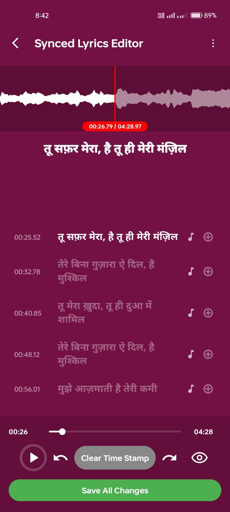
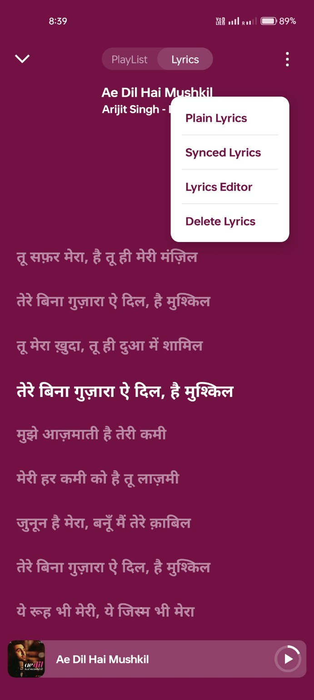
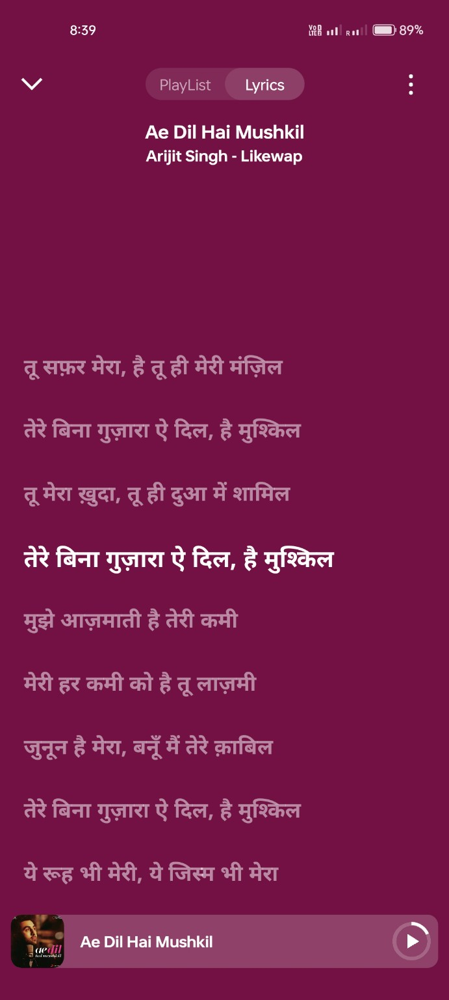
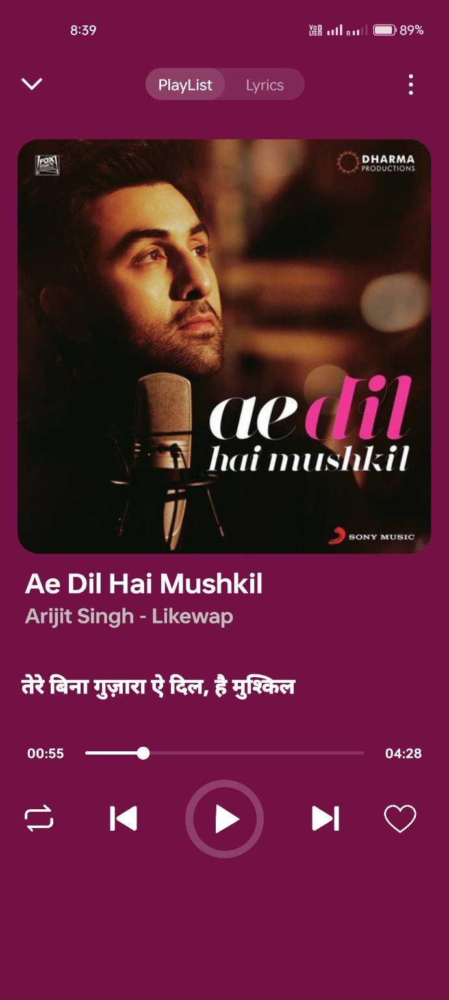
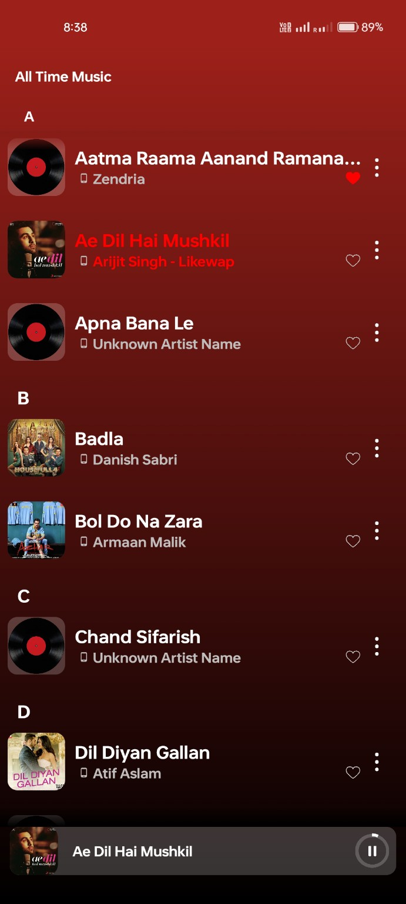

# AllTimeMusic

**AllTimeMusic** is an Android music player project built with Java and Android Studio. It brings your music library, playback controls, favourites, and lyrics tools together in a clean, red-themed interface.

## Features

- **Music library** — browse your tracks in an alphabetically organised list with album artwork and artist information.
- **Now Playing** — view album artwork and track details, seek through a song, and use playback controls.
- **Favourites** — mark tracks you want to find quickly.
- **Lyrics view** — switch between plain and synchronised lyrics.
- **Synced lyrics editor** — work with lyric timestamps using a waveform-based editing screen, adjust timing, and save your changes.

## Built with

- Java
- Android Studio
- Android SDK (min SDK 25; target SDK 37)
- AndroidX and Material Components
- RecyclerView and ViewPager2
- Glide for image loading
- Lottie for animations
- OkHttp
- Amplituda for waveform-related functionality

## Getting started

1. Clone this repository:

   ```bash
   git clone https://github.com/HarshChawariya/AllTimeMusic.git
   ```

2. Open the project in **Android Studio**.
3. Allow Android Studio to sync the Gradle project.
4. Connect an Android device or start an emulator.
5. Build and run the **app** configuration.

## Project details

- **Application ID:** `com.example.alltimemusic`
- **Version:** `1.0` (version code 1)
- **Minimum Android SDK:** 25

## Screenshots

| Music Library | Now Playing |
|:--:|:--:|
|  |  |

| Lyrics View | Lyrics Options |
|:--:|:--:|
|  |  |

| Synced Lyrics Editor |
|:--:|
|  |

## Author

**Harsh Chawariya**

- GitHub: [@HarshChawariya](https://github.com/HarshChawariya)

---

If you find the project useful, feel free to explore the code and share constructive feedback.
